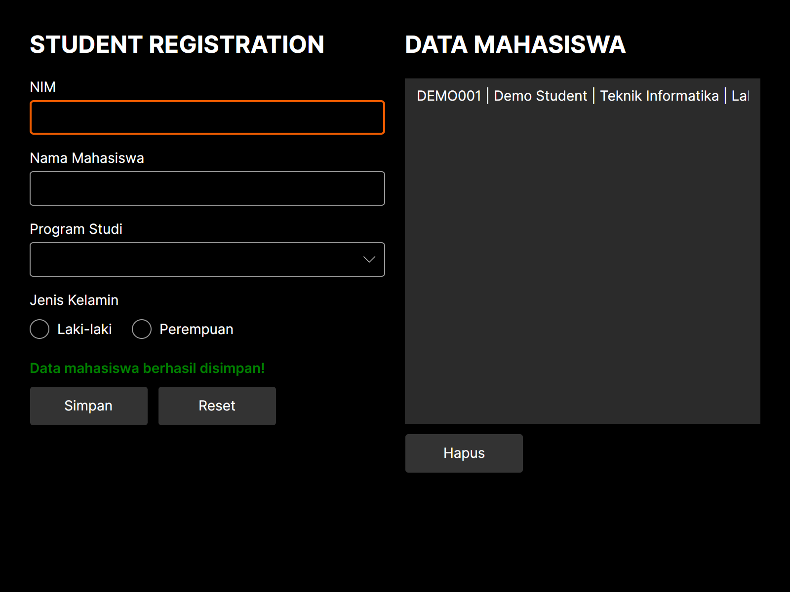
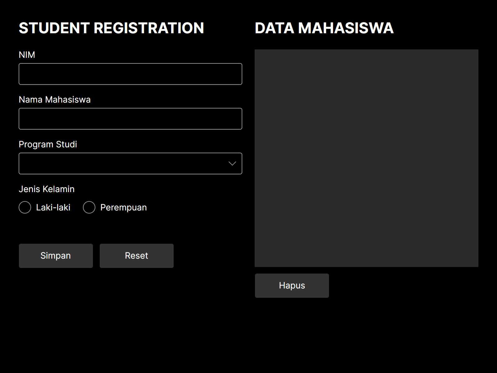
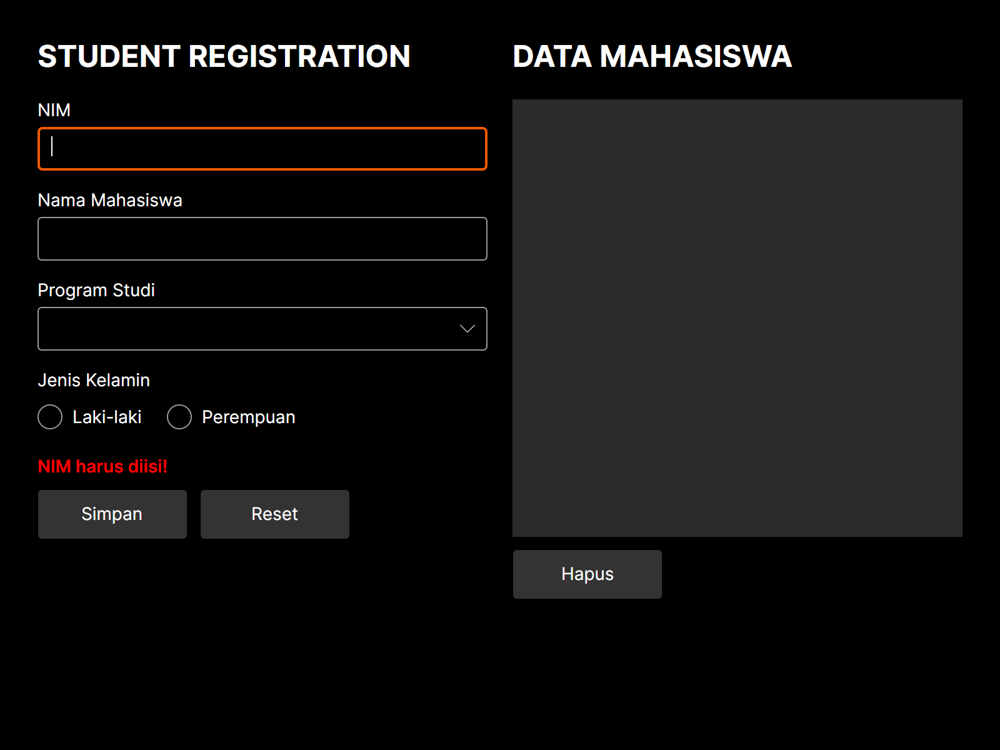
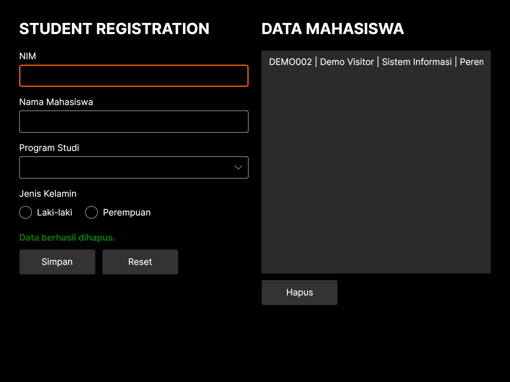

# Student Registration

A desktop registration form for collecting student identifiers, names, study programs, and gender. Saved entries appear beside the form, where users can select and remove records while continuing to register students.



Saving adds the registration to the list and clears the form for the next entry.

## Features

- Register students with a NIM, name, study program, and gender.
- Choose from Teknik Informatika, Sistem Informasi, Manajemen, and Akuntansi.
- Receive inline guidance for required fields.
- Reset the form or delete a selected registration.

Entries are stored in memory for the current application session. An `ObservableCollection<string>` keeps the list synchronized with additions and removals; window event handlers manage the form actions.

## Getting Started

Requires the .NET 10 SDK and a graphical desktop. The interface is built with C# and Avalonia, using the Fluent theme and Inter font.

Run from the repository root:

```sh
dotnet restore StudentRegistrationApp/StudentRegistrationApp.csproj
dotnet build StudentRegistrationApp/StudentRegistrationApp.csproj
dotnet run --project StudentRegistrationApp/StudentRegistrationApp.csproj
```

## Usage

Enter the NIM (student identifier) and name, then choose a program and gender. Select **Simpan** (Save) to add the registration. Required-field messages appear beneath the input fields.

**Reset** clears the form and status message while keeping saved entries. To remove a registration, select its row and choose **Hapus** (Delete).

## Screenshots



The form and list share a single window.



Inline guidance identifies the next field to complete.



The remaining registration stays in the list after deletion.
